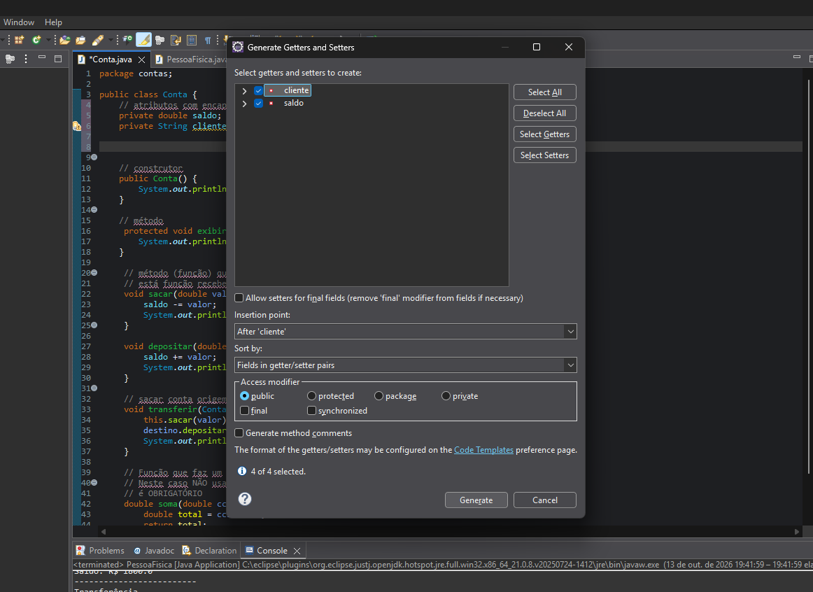

# Encapsulamento

> **Data:** 13 de outubro de 2026

---

### 🟥 Introdução

O encapsulamento é um dos pilares da Programação Orientada a Objetos (POO). Ele está relacionado à proteção dos dados de uma classe, permitindo controlar o acesso às suas variáveis.

Durante a aula, foi apresentado o modificador de acesso `private`, dando continuidade ao conteúdo estudado anteriormente sobre modificadores de acesso.

### Objetivo do encapsulamento

- Reforçar a segurança dos dados.
- Restringir o acesso direto às variáveis de uma classe.
- Permitir maior controle sobre os dados dos objetos.

---

## Encapsulando os atributos da classe modelo `Conta`

Na classe `Conta`, os atributos saldo e cliente, que antes podiam ser acessados diretamente, foram modificados para private.

```java
// Atributos com encapsulamento
private double saldo;
private String cliente;
```

`private` → restringe o acesso direto ao atributo, permitindo que ele seja acessado por meio dos métodos definidos na própria classe.  
`double saldo` → atributo utilizado para armazenar o saldo da conta.  
`String cliente` → atributo utilizado para armazenar o nome do cliente.

Com essa alteração, não podemos mais acessar esses atributos diretamente de outras classes como fazíamos anteriormente.

---

## Criando os métodos getters e setters

Depois de encapsular os atributos, utilizamos o recurso do Eclipse para gerar os métodos de acesso.

Caminho utilizado no Eclipse:  
Botão direito na classe → `Source` → `Generate Getters and Setters...` → Marque os atributos selecionados



Gerou os seguintes métodos na classe `Conta`:

```java
// Métodos get e set para acessar as variáveis encapsuladas

public double getSaldo() {
    return saldo;
}

public void setSaldo(double saldo) {
    this.saldo = saldo;
}

public String getCliente() {
    return cliente;
}

public void setCliente(String cliente) {
    this.cliente = cliente;
}
```

### Para que servem esses métodos?

- Getter (get) → permite consultar o valor de um atributo privado.
- Setter (set) → permite atribuir ou modificar o valor de um atributo privado.

Por exemplo, `getSaldo()` retorna o saldo atual da conta, enquanto `setSaldo(10000.00)` define o saldo como 10000.00.

### Entendendo this

No método:

```java
public void setSaldo(double saldo) {
    this.saldo = saldo;
}
```

`this.saldo` → representa o atributo saldo do objeto atual.  
`saldo` → representa o parâmetro recebido pelo método.

Assim, o valor recebido pelo parâmetro é atribuído ao atributo do objeto.

---

## Utilizando os métodos em SeguroPessoaFisica

**Antes** do encapsulamento, os atributos eram acessados diretamente:

```java
SeguroPessoaFisica cc3 = new SeguroPessoaFisica();

cc3.cliente = "Junior Magalhães";
cc3.saldo = 9000;

System.out.println("Cliente: " + cc3.cliente);
cc3.exibirSaldo();
```

**Depois** de transformar os atributos em private, o código passou a utilizar os getters e setters:

```java
SeguroPessoaFisica cc3 = new SeguroPessoaFisica();

cc3.setCliente("Junior Magalhães");
cc3.setSaldo(9000);

System.out.println("Cliente: " + cc3.getCliente());
cc3.exibirSaldo();
}
```

O que mudou?

`setCliente("Junior Magalhães")` → define o nome do cliente.  
`setSaldo(9000)` → define o saldo da conta.  
`getCliente()` → retorna o nome do cliente para exibição.  
`exibirSaldo()` → continua sendo utilizado para mostrar o saldo.

### Aplicando o encapsulamento em PessoaFisica

Depois do exemplo com `SeguroPessoaFisica`, o professor propôs aplicar o mesmo conceito na classe `PessoaFisica`.

A alteração consistiu em substituir o acesso direto aos atributos cliente e saldo pelos métodos **getters** e **setters**.
