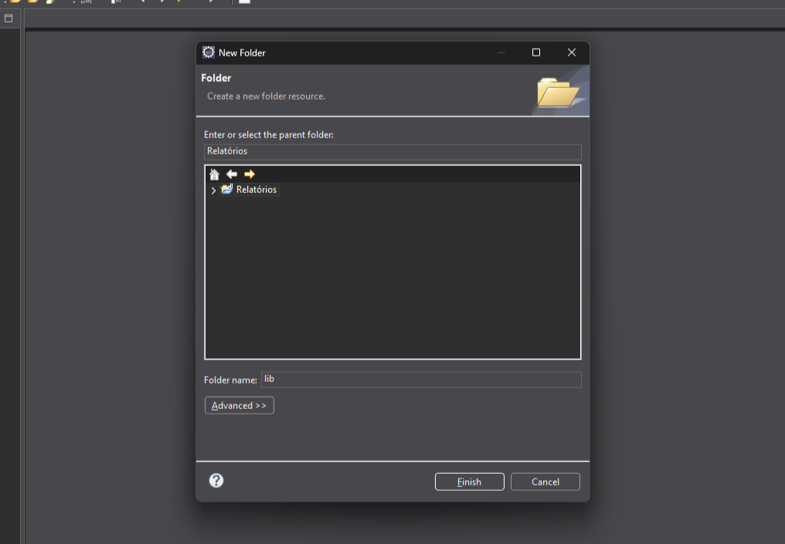
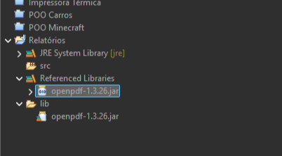
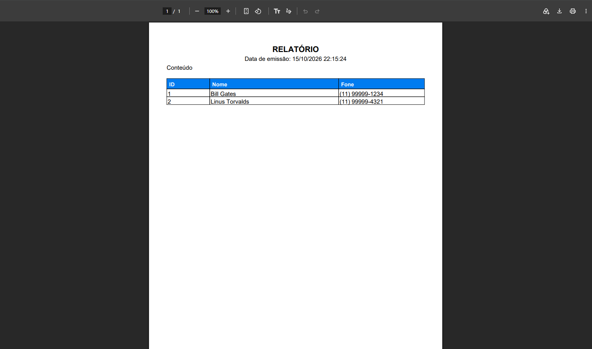

# Criação de relatórios em PDF com Java

> **Data:** 15 de outubro de 2026

Trabalhamos com a criação de relatórios em PDF utilizando Java. Para isso, criamos um novo projeto no Eclipse e adicionamos uma biblioteca externa chamada **OpenPDF**, que permite gerar documentos PDF.

---

## Criando o projeto

Primeiro, finalizamos os projetos Java anteriores e criamos um novo projeto chamado `Relatórios`.

Dentro do projeto, criamos uma pasta chamada `lib`, utilizada para **armazenar a biblioteca externa** que seria utilizada na aula.

New → Folder → Folder name: lib → Finish



O professor disponibilizou o arquivo: *`openpdf-1.3.26.jar`*

Em **File Operation** selecionando "**Copy Files**" e OK.

Depois, adicionamos a biblioteca ao projeto:

1. Clique com o botão direito no arquivo openpdf-1.3.26.jar.
2. Selecione Build Path.
3. Clique em Add to Build Path.

↳ Build Path → define as bibliotecas e dependências que o projeto Java utiliza para compilar e executar o código.

### Por que utilizamos um arquivo `.jar`?

Um arquivo `.jar` pode reunir classes Java que oferecem funcionalidades reutilizáveis. Nesse caso, utilizamos o OpenPDF para gerar documentos PDF.

O professor explicou que normalmente podemos utilizar o Maven para gerenciar dependências, mas, nessa aula, fizemos a configuração manualmente pelo arquivo `.jar`.



Dentro da "pasta" `src`, criamos o package `report`, em seguida, criamos a classe `RelatorioTemplate`.

---

## Gerando PDF

### Criando o documento PDF

1. Primeiro, criamos um objeto Document para representar o documento PDF.

```java
Document document = new Document(PageSize.A4);   // vertical
```

↳ `Document` → classe utilizada para representar o documento que será criado.  
↳ `PageSize.A4` → define o tamanho da página como A4.

Também conhecemos a seguinte forma:

```java
Document document = new Document(PageSize.A4.rotate());   // horizontal
```

↳ `rotate()` → retorna o tamanho A4 com a orientação horizontal, também chamada de landscape.

2. Definindo o caminho do arquivo:

```java
String caminho = "relatório.pdf";
```

↳ `String` → tipo de dado utilizado para armazenar textos.  
↳ `caminho` → variável que armazena o nome ou caminho do arquivo PDF.

Nesse exemplo, o arquivo é criado com o nome `relatório.pdf` no diretório de trabalho utilizado pelo programa.

3. Criando o arquivo e abrindo o documento:

```java
PdfWriter.getInstance(document,new FileOutputStream(caminho));

document.open();   // início
```

↳ `PdfWriter.getInstance()` → configura a escrita do conteúdo no arquivo PDF.  
↳ `FileOutputStream(caminho)` → cria um fluxo de saída para gravar os dados no arquivo indicado.  
↳ `document.open()` → inicia a inclusão do conteúdo no documento.

Depois de abrir o documento, podemos adicionar textos, títulos e tabelas.

### Finalizando e abrindo o PDF

Depois de adicionar todo o conteúdo, fechamos o documento e abrimos o arquivo gerado no leitor padrão do sistema operacional.

```java
document.close();   // fim
File arquivo = new File(caminho);
Desktop.getDesktop().open(arquivo);
```

↳ `document.close()` → finaliza o documento PDF e conclui sua gravação.  
↳ `File` → representa o arquivo no sistema de arquivos.  
↳ `Desktop.getDesktop()` → permite acessar funcionalidades da área de trabalho do sistema operacional.  
↳ `open(arquivo)` → solicita a abertura do arquivo no aplicativo padrão associado a ele.

Assim, após executar o programa, o PDF é gerado e o sistema tenta abri-lo automaticamente.

---

## Adicionando um parágrafo

Para inserir um texto simples no PDF, utilizamos a classe `Paragraph`.

```java
document.add(new Paragraph("Conteúdo"));
```

↳ `Paragraph` → representa um parágrafo de texto.  
↳ `document.add()` → adiciona o elemento ao documento PDF.

Essa estrutura permite inserir textos que farão parte do relatório.

---

## Inserindo a data e a hora

Também utilizamos as classes `LocalDateTime` e `DateTimeFormatter` para obter e formatar a data e a hora da emissão do relatório.

```java
LocalDateTime agora = LocalDateTime.now();
DateTimeFormatter formato = DateTimeFormatter.ofPattern("dd/MM/yyyy HH:mm:ss");
String dataHora = agora.format(formato);
```

↳ `LocalDateTime.now()` → obtém a data e a hora atuais do sistema.  
↳ `DateTimeFormatter.ofPattern()` → define o formato de apresentação.  
↳ `agora.format(formato)` → converte a data e a hora para o formato escolhido.

Depois, criamos um parágrafo com a data de emissão e o centralizamos.

```java
Paragraph dataEmissao = new Paragraph("Data de emissão: " + dataHora);
dataEmissao.setAlignment(Element.ALIGN_CENTER);
document.add(dataEmissao);
```

↳ `setAlignment()` → define o alinhamento do parágrafo.  
↳ `Element.ALIGN_CENTER` → centraliza o texto.

---

## Personalizando o título

Para deixar o relatório mais organizado, adicionamos um título personalizado.

```java
Font fontTitulo = new Font(Font.HELVETICA, 16, Font.BOLD);
Paragraph titulo = new Paragraph("RELATÓRIO", fontTitulo);
titulo.setAlignment(Element.ALIGN_CENTER);
document.add(titulo);
```

↳ `Font` → permite definir características da fonte.  
↳ `Font.HELVETICA` → seleciona a fonte Helvetica.  
↳ `16` → define o tamanho da fonte.  
↳ `Font.BOLD` → aplica o estilo negrito.  
↳ `Paragraph` → cria o parágrafo que contém o título.  
↳ `Element.ALIGN_CENTER` → centraliza o título na página.

---

## Criando uma tabela no PDF

Uma das etapas da aula foi criar uma tabela com três colunas: ID, Nome e Fone.

```java
PdfPTable tabela = new PdfPTable(3);
tabela.setWidths(new float[] {1.0f, 3.0f, 2.0f});
tabela.setWidthPercentage(100);
```

↳ `PdfPTable(3)` → cria uma tabela com três colunas.  
↳ `setWidths()` → define as proporções das larguras das colunas.  
↳ `new float[] {1.0f, 3.0f, 2.0f}` → define proporções de largura de 1, 3 e 2.  
↳ `setWidthPercentage(100)` → faz a tabela ocupar 100% da largura disponível no documento.

### Personalizando o cabeçalho

Criamos uma fonte branca em negrito e uma cor de fundo azul para as células do cabeçalho.

```java
Font fontCabecalho = new Font(Font.HELVETICA, 11, Font.BOLD, java.awt.Color.WHITE);
java.awt.Color corCabecalho = new java.awt.Color(0, 124, 240);
```

↳ `java.awt.Color.WHITE` → representa a cor branca.  
↳ `new java.awt.Color(0, 124, 240)` → cria uma cor utilizando valores RGB: vermelho, verde e azul.

Os valores RGB variam de 0 a 255 para cada componente.

### Adicionando as células do cabeçalho

```java
String[] colunas = {"ID", "Nome", "Fone"};
for (int i = 0; i < colunas.length; i++) {
    PdfPCell celulaCabecalho = new PdfPCell(new Paragraph(colunas[i], fontCabecalho));
    celulaCabecalho.setBackgroundColor(corCabecalho);
    celulaCabecalho.setPadding(5f);
    tabela.addCell(celulaCabecalho);
}
```

↳ `String[]` → cria um vetor de textos.  
↳ `colunas.length` → informa a quantidade de elementos do vetor.  
↳ `for` → repete as instruções para percorrer os elementos do vetor.  
↳ `PdfPCell` → representa uma célula da tabela.  
↳ `setBackgroundColor()` → define a cor de fundo da célula.  
↳ `setPadding(5f)` → define o espaçamento interno da célula.  
↳ `tabela.addCell()` → adiciona a célula à tabela.

```java
celulaCabecalho.setHorizontalAlignment(Element.ALIGN_CENTER);   // centraliza o conteúdo das células
```

O laço for permite criar as células do cabeçalho sem precisar escrever cada uma separadamente.

---

## Inserindo os dados da tabela

Depois do cabeçalho, adicionamos dados de exemplo para preencher o corpo da tabela.

```java
tabela.addCell("1");
tabela.addCell("Bill Gates");
tabela.addCell("(11) 99999-1234");

tabela.addCell("2");
tabela.addCell("Linus Torvalds");
tabela.addCell("(11) 99999-4321");

document.add(tabela);
```

↳ `addCell()` → adiciona uma célula à tabela.

Os dados foram inseridos na sequência das colunas: ID, nome e telefone.

---

## Bibliotecas utilizadas

Ao longo da atividade, adicionamos os imports necessários para utilizar as classes do Java e do OpenPDF.

```java
// Biblioteca interna para interface com o sistema operacional
import java.awt.Desktop;

// Bibliotecas internas para entrada e saída de arquivos
import java.io.File;
import java.io.FileOutputStream;

// Bibliotecas internas para data e hora
import java.time.LocalDateTime;
import java.time.format.DateTimeFormatter;

// Biblioteca externa: OpenPDF
import com.lowagie.text.Document;
import com.lowagie.text.Element;
import com.lowagie.text.Font;
import com.lowagie.text.PageSize;
import com.lowagie.text.Paragraph;
import com.lowagie.text.pdf.PdfPCell;
import com.lowagie.text.pdf.PdfPTable;
import com.lowagie.text.pdf.PdfWriter;
```

---

## Resultado da atividade

A imagem abaixo mostra um exemplo de relatório PDF gerado em Java durante a aula, utilizando a biblioteca OpenPDF. O documento contém título, data e hora de emissão e uma tabela formatada com dados de exemplo.


