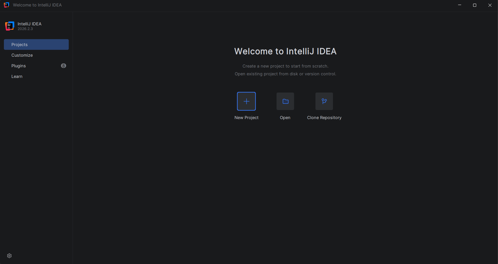

# Introdução ao IntelliJ

> **Data:** 16 de outubro de 2026

Começamos a conhecer o IntelliJ IDEA, uma IDE utilizada para desenvolver aplicações em Java. Também retomamos o MySQL Workbench.

---

## IntelliJ IDEA

O IntelliJ IDEA é um ambiente de desenvolvimento integrado (IDE) utilizado para escrever, executar e organizar códigos, incluindo projetos em Java.



### Primeiro programa em Java

Criamos um pacote chamado `fundamentos` e uma classe chamada `Hello`. Semelhante ao nosso primeiro Java Project feito no Eclipse IDE.

```java
package fundamentos;

// Classe modelo
public class Hello {

    // Método principal
    public static void main(String[] args) {
        System.out.println("Hello World!");
    }
}
```

---

## MySQL Workbench

Voltamos a utilizar o MySQL Workbench para criar um banco de dados chamado `agenda`.

Para abrir uma nova aba de consulta SQL, utilizamos o caminho: File → New Query Tab

### Criando o banco de dados

```sql
CREATE DATABASE IF NOT EXISTS agenda
DEFAULT CHARACTER SET utf8
DEFAULT COLLATE utf8_general_ci;

USE agenda;
```

### Criando a tabela contato

```sql
CREATE TABLE contato (
    idContato INT AUTO_INCREMENT PRIMARY KEY,
    nome VARCHAR(30) NOT NULL,
    fone VARCHAR(15) NOT NULL
);
```

### Verificando a estrutura da tabela

```sql
DESC contato;
```

↳ `DESC` → mostra a estrutura da tabela, incluindo as colunas, os tipos de dados e algumas de suas propriedades.
