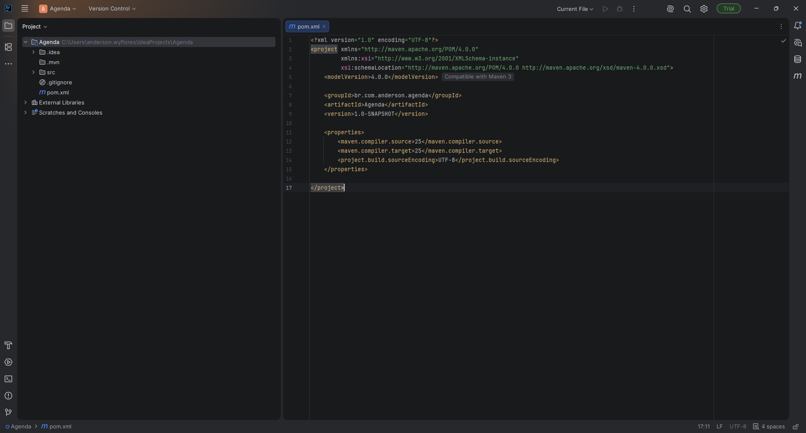
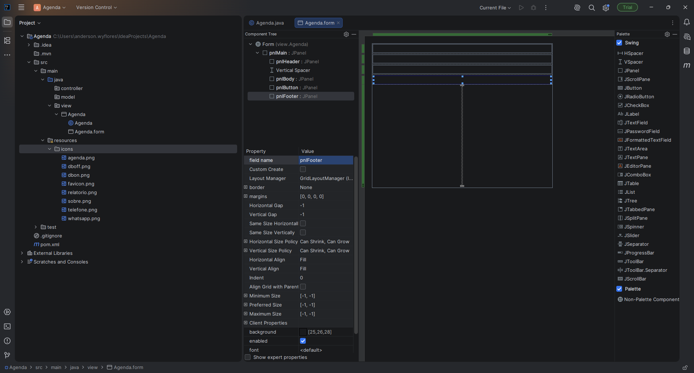
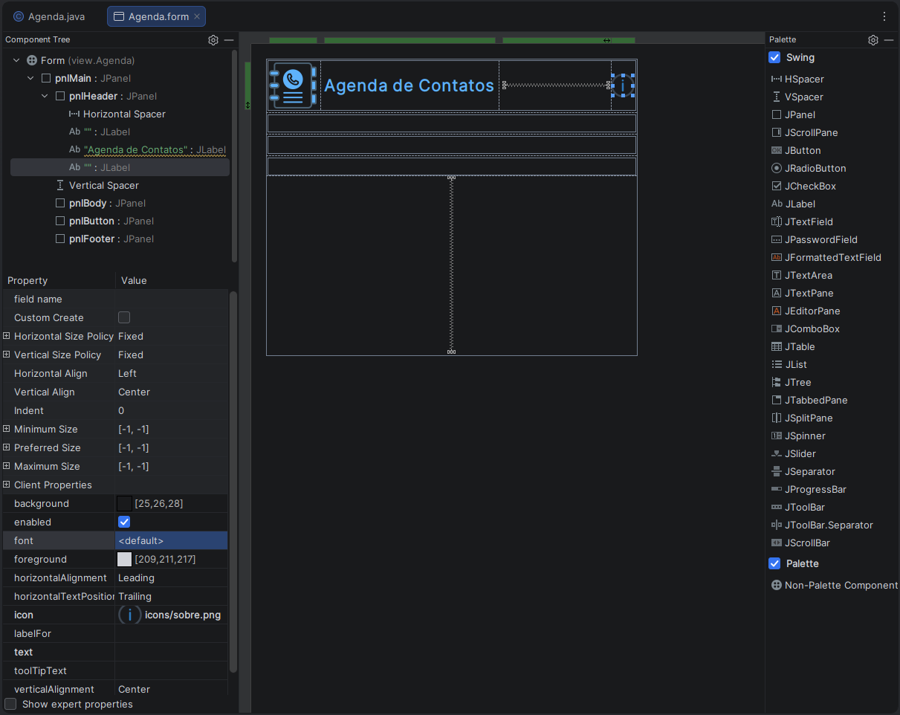
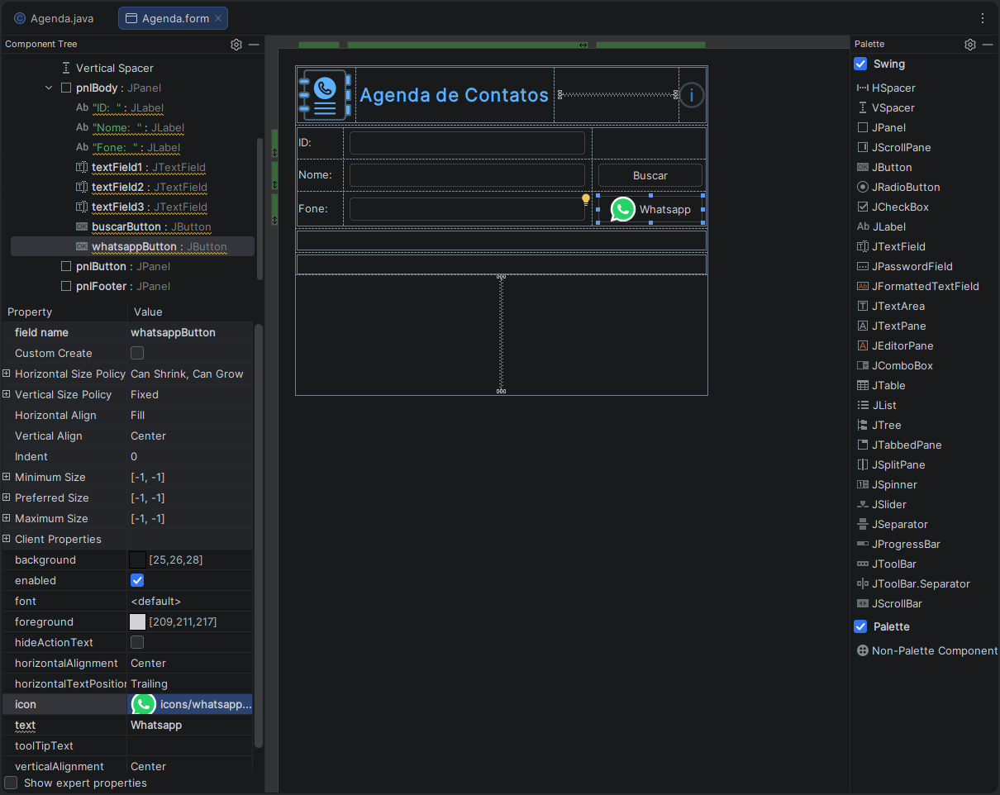
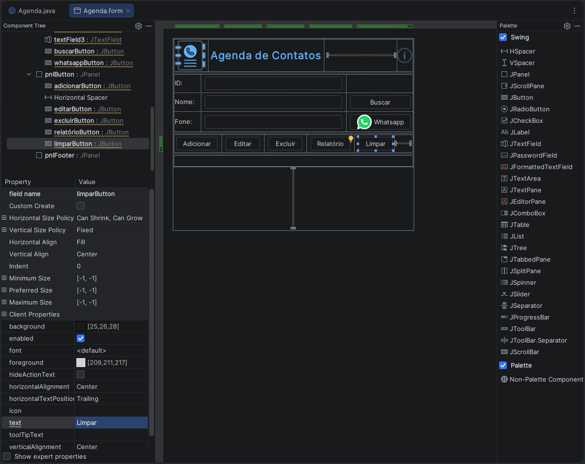
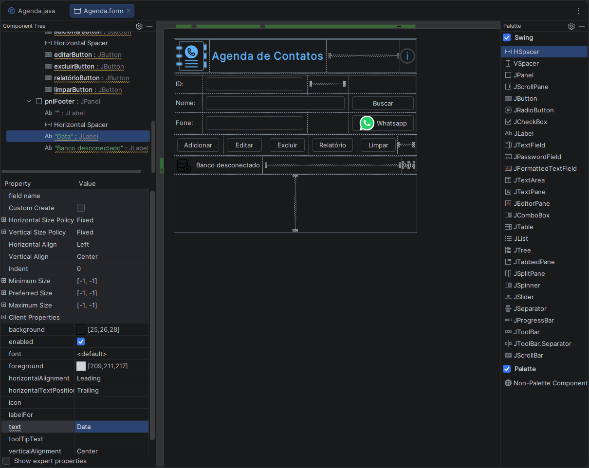

# Retornando ao Intellij IDEA

> **Data:** 19 de outubro de 2026

Voltamos a utilizar o IntelliJ IDEA para desenvolver um projeto Java que será integrado a um banco de dados.

---

## Apache Maven

O **Apache Maven** é uma ferramenta de gerenciamento de projetos Java. Ele facilita a organização do projeto e o gerenciamento das bibliotecas necessárias para seu funcionamento.

As dependências podem ser declaradas no arquivo pom.xml, permitindo que o Maven gerencie sua inclusão no projeto.

---

## MVC - Model, View e Controller

O MVC (Model, View e Controller) é um padrão de arquitetura que organiza uma aplicação em três componentes principais, separando responsabilidades.

### Model

Responsável por representar e organizar os dados utilizados pela aplicação. Pode armazenar temporariamente informações recebidas da interface ou preparadas para processamento.

### View

Responsável pela interface gráfica apresentada ao usuário, incluindo formulários, campos de texto, botões, imagens e outros elementos visuais.

### Controller

Responsável por receber as ações ou solicitações originadas na View e coordenar o processamento necessário, encaminhando os dados para as partes responsáveis pelas operações da aplicação.

---

## DAO - Data Access Object

O DAO (Data Access Object) é um padrão utilizado para separar o acesso ao banco de dados das demais responsabilidades da aplicação.

Em um projeto Java, o DAO pode implementar operações para cadastrar, consultar, alterar e excluir registros.

Na estrutura apresentada em aula, o DAO é responsável pela comunicação com o banco de dados, enquanto o Controller coordena o fluxo das solicitações.

---

## Criando um Projeto Java Agenda

No IntelliJ IDEA, criamos um novo projeto Java chamado **Agenda**, que será utilizado no desenvolvimento da aplicação de agenda de contatos.

### Configurando o projeto

1. Clique em **New Project** para criar um novo projeto.
2. Selecione a opção Maven.
3. Expanda a seção **Advanced Settings**.
4. No campo **GroupId**, informe: `br.com.anderson.agenda`
5. Mantenha o campo **ArtifactId** com o valor sugerido pelo IntelliJ.
6. Clique em Create para criar o projeto.

O **GroupId** identifica o grupo ou domínio ao qual o projeto pertence. Já o **ArtifactId** identifica o projeto dentro desse grupo.

### Estrutura do projeto

Após a criação, foi gerada a estrutura inicial do projeto Java com Maven.

---

## Preparando o projeto para a interface gráfica

Antes de criar a interface da agenda, instalamos uma extensão no IntelliJ IDEA e organizamos as pastas que serão utilizadas no projeto.

### Instalando o Swing UI Designer

O **Swing UI Designer** é um plugin que permite criar interfaces gráficas com componentes visuais, como painéis, botões, campos de texto e rótulos, por meio de um editor de formulários.

Para instalá-lo:

1. Acesse Settings → Plugins.
2. Pesquise por Swing UI Designer.
3. Clique para instalar o plugin.
4. Reinicie a IDE quando solicitado.

### Criando a pasta de ícones

Dentro de src/main/resources, criamos um diretório chamado "icons".

resources → New → Directory → name: icons

Essa pasta será utilizada para armazenar as imagens e os ícones empregados na interface gráfica.

### Criando os pacotes Java

Dentro de src/main/java, criamos três pacotes para organizar as partes da aplicação:

- **controller** - responsável por coordenar as ações da aplicação.
- **model** - responsável por representar e organizar os dados.
- **view** - responsável pela interface gráfica.

Essa organização segue a estrutura MVC apresentada anteriormente.

---

## Criando o formulário Agenda

Depois de instalar o plugin Swing UI Designer e criar os pacotes do projeto, começamos a montar a interface gráfica da aplicação.

Para criar o formulário:

1. Acesse o pacote **view**, dentro de src/main/java.
2. Clique com o botão direito no pacote.
3. Selecione New > Swing UI Designer > Form.
4. No campo Form name, coloque Agenda.

O formulário será utilizado para construir visualmente a interface da agenda de contatos.

### Criando os painéis

Inicialmente, criamos o painel principal e definimos seu nome como **pnlMain**.

Em seguida, adicionamos outros quatro painéis para organizar os elementos da interface:

- **pnlHeader** - região superior, destinada ao cabeçalho.
- **pnlBody** - região central, destinada aos campos de identificação e contato.
- **pnlButton** - região destinada aos botões de operações.
- **pnlFooter** - região inferior, destinada às informações do rodapé.

O pnlMain funciona como o painel principal, que contém os demais painéis.

### Adicionando ícones

Os ícones utilizados na aula foram disponibilizados pelo professor e copiados para a pasta src/main/resources/icons.

### Visualizando o formulário

Para conferir a aparência da interface durante a montagem, clique com o botão direito em uma área do editor e selecione **Preview**.

O Preview permite visualizar como os componentes estão organizados no formulário.

---

## Cabeçalho

Depois de criar os painéis do formulário, começamos a adicionar os elementos visuais do cabeçalho.

### Inserindo o ícone da agenda

1. Adicione um componente **JLabel** no canto superior esquerdo do **pnlHeader**.
2. No campo icon, informe: `icons/agenda.png`
3. Limpe o campo **text**, deixando o rótulo exibir somente o ícone.

### Adicionando o título

Ao lado do primeiro JLabel, adicione outro JLabel com as seguintes propriedades:

- **Text:** Agenda de Contatos  
- **Font Style:** Bold  
- **Font Size:** 22
- **Foreground:** cor escolhida com base no ícone da agenda.

### Inserindo o ícone Sobre

Adicione outro JLabel no canto superior direito do cabeçalho.

- **Icon:** icons/sobre.png
- **Text:** vazio.

---

## Adicionando os campos de contato

No segundo painel, pnlBody, adicionamos os rótulos e os campos de texto que serão utilizados para identificar e consultar os contatos.

Criando os campos

Adicionamos três componentes JLabel, configurando o campo Text com os seguintes valores:

- **ID:**
- **Nome:**
- **Fone:**

Ao lado de cada JLabel, adicionamos um componente **JTextField**, que permitirá inserir ou visualizar os valores correspondentes.

### Adicionando o botão Buscar

Ao lado do campo de texto de Nome, adicionamos um **JButton** com a propriedade:

- **Text:** Buscar

Esse botão fará parte da interface utilizada para localizar contatos.

### Adicionando o botão WhatsApp

Ao lado do campo de texto de Fone, adicionamos outro JButton com as seguintes propriedades:

- **Text:** Whatsapp
- **Icon:** icons/whatsapp.png

O botão foi configurado para exibir o texto e o ícone do WhatsApp.

Nesta etapa, montamos os componentes visuais do formulário. O funcionamento dos botões será registrado quando trabalharmos com a implementação do código.

---

## Adicionando os botões de operações

No terceiro painel, pnlButton, adicionamos cinco componentes JButton, seguindo a sequência utilizada pelo professor:

1. **Adicionar**
2. **Editar**
3. **Excluir**
4. **Relatório**
5. **Limpar**

Para cada botão, configuramos a propriedade **Text** com o nome correspondente à operação.

Esses botões compõem a área de operações da interface da agenda de contatos.

Nesta etapa, organizamos apenas os componentes visuais. A implementação das ações de cada botão será trabalhada posteriormente.

---

## Adicionando os elementos do rodapé

No quarto painel, pnlFooter, adicionamos componentes JLabel para exibir informações relacionadas ao estado da aplicação.

### Indicador de conexão com o banco

Adicionamos um JLabel com as seguintes propriedades:

- **Icon:** icons/dboff.png
- **Text:** vazio.

Ao lado dele, adicionamos outro JLabel com o texto: Banco desconectado

O ícone e o texto representam o estado da conexão com o banco de dados na interface.

### Rótulo da data

Também adicionamos um JLabel com o texto: Data

Esse componente foi colocado na região do rodapé destinada à exibição da data.

Nesta etapa, configuramos os elementos visuais do rodapé. A atualização automática da data e do estado da conexão dependerá da implementação do código.

---

## Ajustes de espaçamento e dimensões

Depois de adicionar os componentes, realizamos alguns ajustes para melhorar a organização visual do formulário.

### Spacers

Adicionamos espaçadores verticais e horizontais para criar espaços entre os componentes e organizar melhor os painéis.

- **Vertical Spacer:** cria espaço na direção vertical.
- **Horizontal Spacer:** cria espaço na direção horizontal.

O resultado depende da posição do espaçador e das configurações de layout dos componentes.

### Largura dos botões

Os botões Adicionar, Editar, Excluir, Relatório e Limpar foram configurados com largura (width) de 100.

O objetivo foi manter os botões com larguras iguais, deixando a interface mais organizada.

Também removemos uma parte que havia sobrado na região inferior do rodapé para ajustar a aparência final do formulário.
