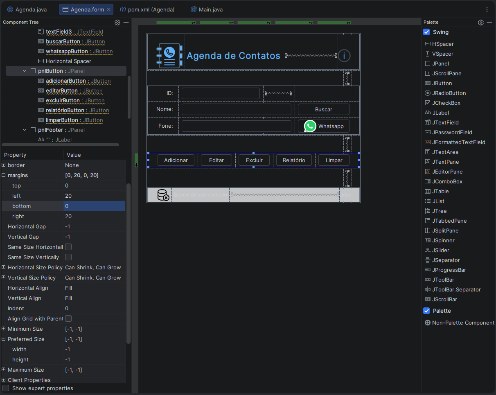
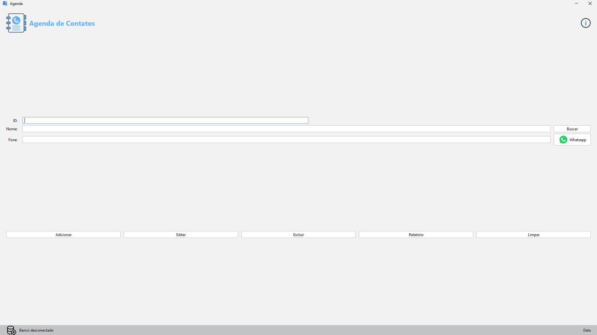
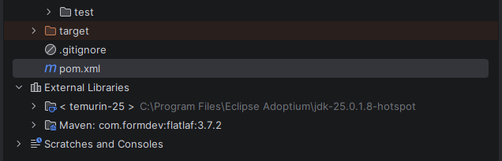
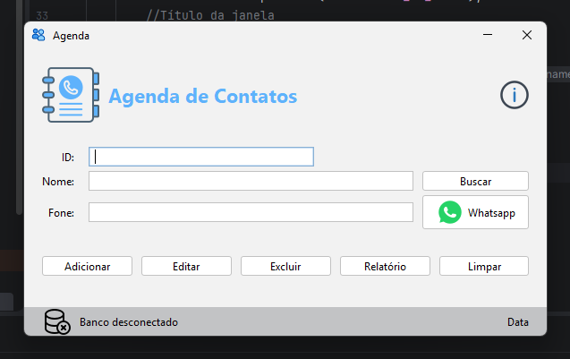

# Implementação da Agenda de Contatos

> **Data:** 20 de outubro de 2026

Continuação da última anotação.

---

## Criação classe Main

Dentro de src/main/java, criamos a classe `Main`, responsável por iniciar a aplicação e abrir a janela principal da `Agenda`.

Para utilizar a classe `Agenda`, importamos ela do pacote view:

```java
import view.Agenda;
```

No método main, criamos um objeto da classe `Agenda` e tornamos a janela visível:

```java
public static void main(String[] args) {
    Agenda janelaPrincipal = new Agenda();

    // Iniciando a janela principal
    janelaPrincipal.setVisible(true);
}
```

`main:` ponto de entrada da aplicação Java.  
`new Agenda():` cria uma instância da classe Agenda.  
`setVisible(true):` torna a janela visível na tela.

Ao executar a classe `Main`, a janela da `Agenda` é aberta.

---

## Configuração da classe Agenda

A classe Agenda, localizada no pacote view, foi modificada para funcionar como uma janela da aplicação.

### Herança de JFrame

```java
package view;

import javax.swing.*;

public class Agenda extends JFrame {
```

`package view;:` indica o pacote ao qual a classe pertence.  
`import javax.swing.*;:` importa as classes do Swing utilizadas na interface.  
`extends JFrame:` faz com que Agenda herde os recursos de uma janela do Swing.

### Componentes do formulário



O UI Designer gera declarações para os componentes adicionados ao formulário, como painéis (JPanel), campos de texto (JTextField), rótulos (JLabel) e botões (JButton).

Essas declarações ficam dentro da classe `Agenda` e permitem que o código Java trabalhe com os componentes da interface.

### Construtor da classe

Criamos um construtor `public Agenda()`, responsável por configurar a janela quando um objeto dessa classe é criado.

```java
public Agenda() {
    // Configurações da janela
}
```

As configurações da janela foram adicionadas dentro desse construtor.

### Configurações da janela

Dentro do construtor `Agenda()`, adicionamos métodos para definir o tamanho, o título, o ícone e o comportamento da janela.

```java
// Tamanho da janela em pixels
setSize(600, 360);

// Comportamento ao fechar a janela
setDefaultCloseOperation(JFrame.EXIT_ON_CLOSE);

// Título da janela
setTitle("Agenda");

// Ícone da janela
ImageIcon icone = new ImageIcon(getClass().getResource("/icons/favicon.png"));
setIconImage(icone.getImage());

// Impedir o redimensionamento
setResizable(false);

// Iniciar em tela cheia
setExtendedState(JFrame.MAXIMIZED_BOTH);

// Remover as bordas e a barra de título
setUndecorated(true);

// Iniciar a janela centralizada
setLocationRelativeTo(null);
```



Função de cada método:

- `setSize(600, 360)`: define a largura de 600 pixels e a altura de 360 pixels.
- `setDefaultCloseOperation(JFrame.EXIT_ON_CLOSE)`: encerra a aplicação quando a janela é fechada pelo botão de fechar.
- `setTitle("Agenda")`: define o título da janela.
- `setIconImage(icone.getImage())`: define o ícone da janela usando a imagem favicon.png, localizada em src/main/resources/icons.
- `setResizable(false)`: impede que o usuário redimensione a janela manualmente.
- `setExtendedState(JFrame.MAXIMIZED_BOTH)`: solicita que a janela seja maximizada horizontal e verticalmente.
- `setUndecorated(true)`: remove as decorações padrão da janela, como a barra de título e as bordas.
- `setLocationRelativeTo(null)`: posiciona a janela no centro da tela quando ela é exibida em seu tamanho normal.

**Observação:** algumas configurações podem entrar em conflito ou deixar de produzir o efeito esperado quando usadas em conjunto. Por exemplo, `setSize(600, 360)` define o tamanho inicial, mas `setExtendedState(JFrame.MAXIMIZED_BOTH)` solicita a maximização. Já `setUndecorated(true)` remove a barra de título e as bordas, o que é útil em interfaces de quiosque ou totens de autoatendimento.

### Integração do formulário com a janela

No construtor da classe `Agenda`, adicionamos o seguinte comando:

```java
// Incluir o formulário (UI Designer - painel principal)
setContentPane(pnlMain);
```

`pnlMain`: é o painel principal criado no Swing UI Designer, que contém os demais painéis e componentes da interface.  
`setContentPane(pnlMain)`: define esse painel como a área de conteúdo da janela JFrame.

Dessa forma, a janela Agenda passa a exibir o formulário que montamos visualmente no editor, incluindo os campos de texto, botões, ícones e demais componentes.

Essa integração permite trabalhar com a interface criada no UI Designer por meio da classe Java Agenda.

---

## Adicionando a biblioteca FlatLaf com Maven

Para deixar a interface com uma aparência mais moderna, adicionamos a biblioteca **FlatLaf** ao projeto por meio do **Maven**.

No arquivo `pom.xml`, incluímos a dependência dentro da seção `<dependencies>`:

```xml
<!-- Dependências externas -->
<dependencies>
    <dependency>
        <groupId>com.formdev</groupId>
        <artifactId>flatlaf</artifactId>
        <version>3.7.2</version>
        <scope>compile</scope>
    </dependency>
</dependencies>
```

### Para que serve essa dependência?

groupId: identifica o grupo responsável pela biblioteca.

- `artifactId`: identifica a biblioteca utilizada, neste caso, flatlaf.
- `version`: especifica a versão 3.7.2.
- `scope`: define em quais etapas a dependência fica disponível. O escopo compile disponibiliza a biblioteca durante a compilação e também em tempo de execução.

Depois de adicionar a dependência e atualizar o projeto Maven, a biblioteca passa a aparecer em **External Libraries no IntelliJ IDEA**.



O Maven gerencia o download e a disponibilização dessa biblioteca para o projeto, evitando a necessidade de adicionar manualmente os arquivos JAR.

---

## Aplicando o tema visual com FlatLaf

Depois de adicionar a dependência ao pom.xml, importamos as classes do FlatLaf no arquivo Main.java:

```java
import com.formdev.flatlaf.FlatDarkLaf;
import com.formdev.flatlaf.FlatLightLaf;
```

Dentro do método main, configuramos o tema claro antes de criar e exibir a janela:

```java
// Uso do FlatLaf (tema visual moderno)
FlatLightLaf.setup();
// FlatDarkLaf.setup();
```

`FlatLightLaf.setup()`: configura o tema claro do FlatLaf.  
`FlatDarkLaf.setup()`: configura o tema escuro, mas permanece comentado no código.

Como a chamada `FlatLightLaf.setup()` está ativa, a aplicação utiliza o tema claro.

A configuração do tema é feita antes da criação da janela Agenda, permitindo que os componentes Swing utilizem a aparência configurada pelo FlatLaf.

### Removendo avisos de acesso nativo

Durante a execução do projeto, o IntelliJ IDEA exibia uma mensagem de WARNING relacionada ao acesso nativo.

Para suprimir esse aviso, o professor utilizou o argumento de execução da JVM: `--enable-native-access=ALL-UNNAMED`

Esse argumento permite o acesso nativo às classes dos módulos indicados, evitando avisos relacionados a esse tipo de acesso quando aplicável.

Importante: esse argumento é configurado nas opções de execução da JVM, não no código Java nem no arquivo `pom.xml`.

Caminho:
1. Clique nos três pontinhos ou no menu da configuração.
2. Botão Run
3. Selecione a configuração da sua aplicação Java, provavelmente Main.
4. Clique em Modify Options.
5. Selecione Add VM Options.
6. No campo VM Options, coloque: `--enable-native-access=ALL-UNNAMED`
7. Clique em Apply e depois em OK.

### Resultado final da aplicação

Após configurar a classe Agenda, integrar o formulário criado no UI Designer e aplicar o tema visual FlatLaf, executamos a classe Main.java para abrir a aplicação.


