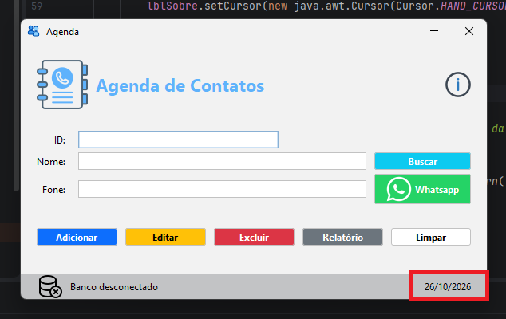
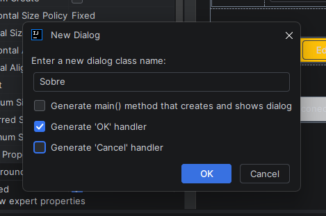
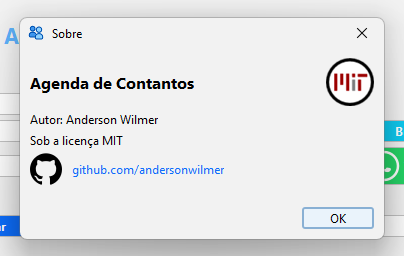
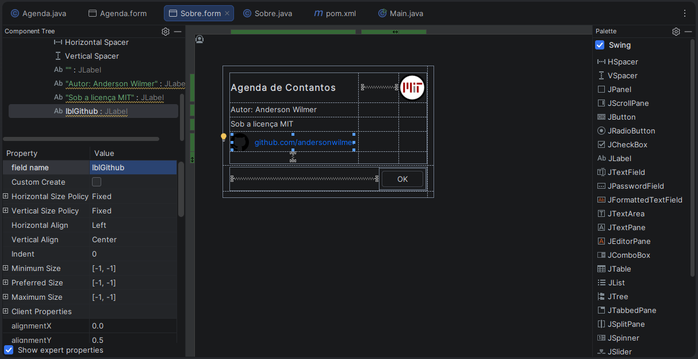

# Java - Agenda: Data e Tela Sobre

> **Data:** 26 de outubro de 2026

---

## Atualizando a data na Agenda

Para exibir a data atual na interface da Agenda, criamos o método atualizarData() na classe Agenda.java, fora do construtor.

```java
private void atualizarData() {
    LocalDate hoje = LocalDate.now();
    DateTimeFormatter formato = DateTimeFormatter.ofPattern("dd/MM/yyyy");
    lblData.setText(hoje.format(formato));
}
```

`private void atualizarData()`: declara um método que pode ser utilizado internamente pela classe Agenda.  
`LocalDate.now()`: obtém a data atual do sistema.  
`DateTimeFormatter.ofPattern("dd/MM/yyyy")`: define o formato da data como dia/mês/ano  
`lblData.setText()`: altera o texto do rótulo para exibir a data formatada.

Para utilizar `LocalDate` e `DateTimeFormatter`, adicionamos os seguintes imports no início do arquivo `Agenda`:

```java
import java.time.LocalDate;
import java.time.format.DateTimeFormatter;
```

### Chamando o método no construtor

Depois de criar o método, adicionamos a chamada `atualizarData();` dentro do construtor da classe `Agenda`.

```java
atualizarData();
```

Assim, quando a janela da `Agenda` é inicializada, o método é executado e o rótulo **lblData** passa a exibir a data atual no formato definido.



---

## Criando a janela Sobre

Para criar uma janela com informações sobre a aplicação, utilizamos o recurso Swing Dialog do IntelliJ IDEA.

No projeto, acessamos a pasta `view`, clicamos com o botão direito e selecionamos **New → Swing Dialog**. Em seguida, definimos o nome Sobre e desmarcamos as opções de geração automática indicadas pelo professor.



Após a criação, o IntelliJ gerou dois arquivos:

- **Sobre.java**: contém o código Java responsável pela configuração e pelo comportamento da janela.
- **Sobre.form**: permite montar a interface visual pelo UI Designer, adicionando componentes como rótulos, imagens e botões.

### Utilizando JDialog

A classe `Sobre` herda de `JDialog`, como mostra a declaração:

```java
public class Sobre extends JDialog {
```

O `JDialog` é utilizado para criar janelas de diálogo, geralmente destinadas a apresentar informações ou solicitar alguma interação do usuário.

### Componentes iniciais

Na criação inicial, o IntelliJ gerou componentes como:

`contentPane`: painel principal da janela.  
`buttonOK`: botão para confirmar e fechar a janela.  
`buttonCancel`: botão Cancelar, gerado inicialmente pelo assistente.

Durante a aula, o código foi ajustado para utilizar o botão OK, e a interface foi personalizada posteriormente pelo UI Designer.

Diferentemente da janela principal da Agenda, que utiliza JFrame, a janela Sobre foi criada como uma janela secundária.

---

## Configurando a janela Sobre

Após criar os arquivos Sobre.java e Sobre.form, configuramos as propriedades da janela dentro do construtor da classe Sobre.

```java
public Sobre() {
    //configuração da janela
    setSize(380,230);

    //comportamento ao fechar
    setDefaultCloseOperation(JDialog.DISPOSE_ON_CLOSE);

    //título
    setTitle("Sobre");

    //Ícone de janela
    ImageIcon icone = new ImageIcon(getClass().getResource("/icons/favicon.png"));
    setIconImage(icone.getImage());

    //Impedir o redimensionamento
    setResizable(false);

    //Iniciar a janela centralizada
    setLocationRelativeTo(null);

    setContentPane(contentPane);
    setModal(true);
    getRootPane().setDefaultButton(buttonOK);
}
```

`setSize(380, 230)`: define a largura de 380 pixels e a altura de 230 pixels.  
`setDefaultCloseOperation(JDialog.DISPOSE_ON_CLOSE)`: ao fechar a janela, descarta essa instância, liberando os recursos associados a ela.  
`setTitle("Sobre")`: define o título exibido na janela.  
`setIconImage(icone.getImage())`: utiliza a imagem favicon.png como ícone da janela.  
`setResizable(false)`: impede que o usuário altere o tamanho da janela arrastando suas bordas.  
`setLocationRelativeTo(null)`: posiciona a janela no centro da tela.  
`setContentPane(contentPane)`: define o painel principal que contém os componentes da interface.  
`setModal(true)`: faz com que a janela de diálogo bloqueie a interação com a janela principal enquanto estiver aberta. Isso evita que o usuário continue utilizando a Agenda até fechar o diálogo.  
`getRootPane().setDefaultButton(buttonOK)`: define o botão OK como botão padrão. Assim, pressionar Enter aciona esse botão.

**Dica:** Também seguimos a orientação do professor de deixar o arquivo Sobre.form com as dimensões correspondentes às da janela configurada no código.

Essa organização ajuda a manter a interface visual coerente com o tamanho definido no Sobre.java.

---

## Abrindo a janela Sobre pelo ícone

Para abrir a janela **Sobre** ao clicar no ícone **lblSobre**, utilizamos um evento de mouse configurado pelo **UI Designer** do IntelliJ IDEA.

No arquivo `Agenda.form`, clicamos com o botão direito no componente lblSobre e selecionamos:

Create Listener → MouseListener → mouseClicked.

Esse procedimento gera o código responsável por detectar o clique do mouse no componente.

### Testando o evento de clique

Inicialmente, utilizamos `IO.println()` para verificar se o evento estava funcionando:

```java
//evento clicar no ícone Sobre para abrir a tela Sobre
lblSobre.addMouseListener(new MouseAdapter() {
    @Override
    public void mouseClicked(MouseEvent e) {
        super.mouseClicked(e);
        IO.println("Teste do Sobre");
    }
});
```

Ao clicar no ícone, a mensagem `Teste do Sobre` era exibida no console. Esse teste ajudou a confirmar que o evento estava sendo executado.

### Criando o método `sobre()`

Depois do teste, criamos um método privado na classe `Agenda`, fora do construtor, para abrir a janela Sobre:

```java
//Abrir a tela Sobre
private void sobre() {
    Sobre sobre = new Sobre();
    sobre.setVisible(true);
}
```

`Sobre sobre = new Sobre();`: cria um objeto da classe `Sobre`, inicializando a janela.  
`sobre.setVisible(true);`: torna a janela visível.

Em seguida, substituímos a mensagem de teste pela chamada do método sobre() no evento de clique:

```java
lblSobre.addMouseListener(new MouseAdapter() {
    @Override
    public void mouseClicked(MouseEvent e) {
        super.mouseClicked(e);
        //IO.println("Teste do Sobre");
        sobre();
    }
});
```

Dessa forma, ao clicar no ícone Sobre da `Agenda`, o método `sobre()` é executado e abre a janela de diálogo criada anteriormente.



---

## Adicionando o link

Na janela Sobre, adicionamos um link para o **GitHub** utilizando um componente JLabel, identificado como **lblGithub**.



No UI Designer, configuramos o texto do link e sua aparência, incluindo a cor azul para indicar visualmente que ele pode ser acessado.

Para indicar que o link pode ser clicado, adicionamos o seguinte código no construtor da classe Sobre:

```java
lblGithub.setCursor(new java.awt.Cursor(Cursor.HAND_CURSOR));
```

### Criando o evento de clique

No arquivo Sobre.form, clicamos com o botão direito no componente lblGithub e selecionamos:

Create Listener → MouseListener → mouseClicked.

Esse procedimento gera o evento que será executado quando o usuário clicar no link.

No código final, utilizamos:

```java
//Evento do link do github (abrir o repositório)
lblGithub.addMouseListener(new MouseAdapter() {
    @Override
    public void mouseClicked(MouseEvent e) {
        super.mouseClicked(e);
        acessarGithub("https://github.com/andersonwilmer");
    }
});
```

Ao clicar no componente, o método `acessarGithub()` é chamado, recebendo o endereço do perfil como parâmetro.

### Criando o método acessarGithub()

Fora do construtor, criamos o método responsável por abrir o endereço no navegador padrão do computador:

```java
//método para abrir um link no navegador padrão do desktop cliente
private void acessarGithub(String url) {
    Desktop desktop = Desktop.getDesktop();
    try {
        URI uri = new URI(url);
        desktop.browse(uri);
    } catch (Exception e) {
        throw new RuntimeException(e);
    }
}
```

`Desktop.getDesktop()`: obtém uma instância da classe `Desktop`, que permite interagir com recursos do ambiente de trabalho.  
`new URI(url)`: cria um objeto URI a partir do endereço recebido.  
`desktop.browse(uri)`: solicita a abertura do endereço no navegador padrão.  
`try e catch`: permitem tratar exceções que podem ocorrer durante a criação do endereço ou a tentativa de abertura.  
`throw new RuntimeException(e)`: lança uma exceção em tempo de execução caso ocorra um erro.

Assim, quando o usuário clica no link azul do GitHub, o evento chama o método `acessarGithub()`, que tenta abrir o perfil no navegador padrão.

Para esse código, precisamos das seguintes importações no início de Sobre.java:

```java
import java.awt.Desktop;
import java.awt.Cursor;
import java.awt.event.MouseAdapter;
import java.awt.event.MouseEvent;
import java.net.URI;
```
