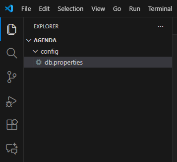
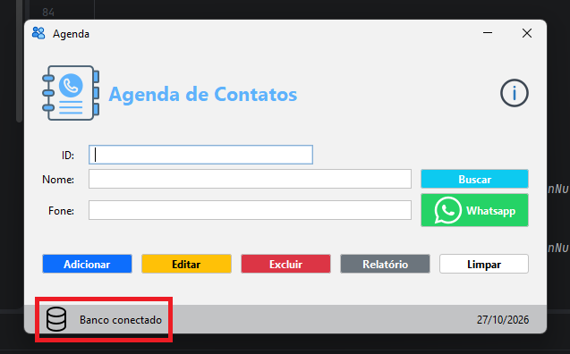

# Java - Agenda: Conexão com MySQL

> **Data:** 27 de outubro de 2026

Conectando o Projeto Java com um Banco de Dados

---

## Preparando a configuração do banco de dados

Para conectar a aplicação Agenda ao MySQL, precisamos configurar o endereço do banco de dados e as credenciais de acesso.

### Arquivo db.properties

Primeiro, acessamos a pasta do usuário do Windows:

Este Computador → Disco Local (C:) → Usuários → Seu usuário

Nessa pasta, criamos o diretório **Agenda**. Em seguida, abrimos esse diretório no Visual Studio Code e criamos a pasta **config**, contendo o arquivo **db.properties**.



**Importante:** o arquivo db.properties precisa estar nesse caminho esperado pela aplicação, dentro da pasta Agenda/config localizada no diretório do usuário.

### Configurações da conexão

Dentro do arquivo `db.properties`, adicionamos as seguintes propriedades:

```properties
db.url=JDBC:mysql://localhost:3306/agenda
db.user=root
db.password=
```

- `db.url`: informa o endereço do banco de dados. localhost indica que o MySQL está no próprio computador, 3306 é a porta padrão e agenda é o nome do banco.  
- `db.user`: informa o usuário utilizado para acessar o MySQL, neste caso, root.  
- `db.password`: informa a senha desse usuário. Na configuração da aula, ela foi deixada vazia.

O arquivo permite manter as configurações de acesso separadas do código Java, facilitando sua alteração sem precisar modificar a classe responsável pela conexão.

---

## Adicionando o MySQL Connector ao Maven

Para permitir a comunicação entre a aplicação Java e o banco de dados MySQL, utilizamos o MySQL Connector/J, um driver JDBC.

### Adicionando a dependência

Acessamos o site [Maven Repository](https://mvnrepository.com/), pesquisamos por **mysql-connector-j** e selecionamos a versão **8.4.0**.

Na página da biblioteca, copiamos o código da seção Maven e adicionamos ao arquivo pom.xml, dentro da tag `<dependencies>`, abaixo da dependência do FlatLaf.

```xml
<!-- Source: https://mvnrepository.com/artifact/com.mysql/mysql-connector-j -->
<dependency>
    <groupId>com.mysql</groupId>
    <artifactId>mysql-connector-j</artifactId>
    <version>8.4.0</version>
    <scope>compile</scope>
</dependency>
```

`groupId`: identifica o grupo ao qual a biblioteca pertence.  
`artifactId`: identifica a biblioteca utilizada, neste caso, o MySQL Connector/J.  
`version`: define a versão da biblioteca, 8.4.0.  
`scope`: define em quais etapas a dependência estará disponível. O valor compile permite utilizá-la durante a compilação e em tempo de execução.

Após salvar o arquivo `pom.xml`, o Maven pode baixar a biblioteca e disponibilizá-la no projeto.

O MySQL Connector/J permite que o Java se comunique com o MySQL por meio do JDBC. Já o arquivo `db.properties` guarda as informações utilizadas para estabelecer essa conexão.

---

## Criando o pacote `connection` e a classe `ConnectionFactory`

criamos um pacote chamado `connection` dentro de src/main/java, em seguida no pacote criamos uma classe, definindo o nome `ConnectionFactory`.

Essa classe será responsável por centralizar o processo de conexão com o banco de dados MySQL.

### Importações da classe

Na classe `ConnectionFactory`, adicionamos as seguintes importações:

```java
//Importações relacionadas ao arquivo db.properties
import java.io.FileInputStream;
import java.io.IOException;
import java.nio.file.Path;

//Importações relacionadas à conexão com o banco
import java.sql.Connection;
import java.sql.DriverManager;
import java.sql.SQLException;
import java.util.Properties;
```

`FileInputStream`: permite ler o conteúdo de um arquivo.  
`IOException`: representa erros relacionados à leitura ou ao acesso de arquivos.  
`Path`: permite representar e organizar o caminho de um arquivo no sistema.  
`Connection`: representa a conexão com o banco de dados.  
`DriverManager`: permite estabelecer uma conexão utilizando as informações fornecidas.  
`SQLException`: representa erros relacionados às operações com o banco de dados.  
`Properties`: permite carregar e consultar as propriedades armazenadas no arquivo db.properties.

### Métodos da classe

A classe `ConnectionFactory` possui dois métodos principais:

- `conectar()`: lê as configurações do arquivo db.properties e tenta estabelecer uma conexão com o banco de dados.
- `testarConexao()`: verifica se a conexão foi estabelecida corretamente, retornando true ou false.

Esses métodos permitem centralizar a lógica de conexão, facilitando sua utilização em outras partes da aplicação.

---

## Criando o método conectar()

Na classe `ConnectionFactory`, criamos o método `conectar()`, responsável por ler as configurações do arquivo `db.properties` e estabelecer a conexão com o banco de dados MySQL.

```java
//método responsável por conectar o banco
public Connection conectar() throws SQLException {

    Properties propriedades = new Properties();

    Path arquivo = Path.of(
            System.getProperty("user.home"),
            "Agenda", "config", "db.properties"
    );

    //Lê o arquivo db.properties
    try (FileInputStream entrada = new FileInputStream(arquivo.toFile())) {
        propriedades.load(entrada);
    } catch (IOException e) {
        throw new SQLException("Erro ao ler db.properties.", e);
    }

    //Retorna a conexão para o pedido do cliente
    return DriverManager.getConnection(
            propriedades.getProperty("db.url"),
            propriedades.getProperty("db.user"),
            propriedades.getProperty("db.password")
    );
}
```

### Localizando o arquivo de configuração

Para encontrar o arquivo `db.properties`, utilizamos:

```java
Path arquivo = Path.of(
        System.getProperty("user.home"),
        "Agenda", "config", "db.properties"
);
```

`System.getProperty("user.home")`: obtém o caminho do diretório pessoal do usuário do sistema operacional.  
`Path.of()`: combina os diretórios informados para formar o caminho do arquivo.

Dessa forma, o programa procura o arquivo dentro da pasta Agenda/config, localizada no diretório pessoal do usuário.

### Carregando as propriedades

```java
try (FileInputStream entrada = new FileInputStream(arquivo.toFile())) {
    propriedades.load(entrada);
} catch (IOException e) {
    throw new SQLException("Erro ao ler db.properties.", e);
}
```

O `FileInputStream` abre o arquivo para leitura, enquanto `propriedades.load(entrada)` carrega suas configurações para o objeto `Properties`.

O bloco `try-with-resources` fecha automaticamente o recurso utilizado para ler o arquivo ao final da operação, inclusive quando ocorre uma exceção.

Caso aconteça um erro ao acessar ou ler o arquivo, o catch captura a `IOException` e lança uma `SQLException` com uma mensagem explicativa e a exceção original como causa.

### Estabelecendo a conexão com o MySQL

```java
return DriverManager.getConnection(
        propriedades.getProperty("db.url"),
        propriedades.getProperty("db.user"),
        propriedades.getProperty("db.password")
);
```

Se a conexão for estabelecida, o método retorna um objeto `Connection`, que poderá ser utilizado por outras partes da aplicação para executar operações no banco.

A declaração `throws SQLException` informa que o método pode lançar uma exceção relacionada à conexão, deixando o tratamento desse erro para quem o chamar.

**Importante:** o `try-with-resources` utilizado na leitura do arquivo fecha automaticamente o `FileInputStream`. Ele não fecha a conexão com o banco, pois essa conexão é retornada pelo método e precisa ser gerenciada por quem a utilizar.

---

## Testando a conexão com o banco de dados

Além do método `conectar()`, criamos o método `testarConexao()`, responsável por verificar se a aplicação consegue estabelecer uma conexão válida com o MySQL.

```java
//método usado apenas para testar a conexão
//retorno é true ou false
public boolean testarConexao() {
    try (Connection conexao = conectar()) {
        return conexao.isValid(3); //limite de tempo para verificar a conexão
    } catch (SQLException e) {
        System.err.println(e.getMessage());
        return false;
    }
}
````

`public boolean testarConexao()`: declara um método público que retorna um valor booleano, ou seja, true ou false.  
`conectar()`: chama o método que lê as configurações e tenta estabelecer a conexão com o banco.  
`Connection conexao`: armazena a conexão estabelecida.  
`conexao.isValid(3)`: verifica se a conexão é válida, utilizando 3 como limite de tempo em segundos para a verificação.  
`catch (SQLException e)`: captura erros relacionados à conexão ou à consulta de sua validade.  
`System.err.println(e.getMessage())`: exibe a mensagem do erro no console de erros.  
`return false`: indica que não foi possível concluir o teste com sucesso.

### Utilizando try-with-resources

Assim como na leitura do arquivo de configuração, utilizamos o `try-with-resources`. Nesse caso, ele fecha automaticamente a conexão com o banco ao sair do bloco, inclusive quando ocorre uma exceção.

Isso é importante porque esse método serve apenas para testar a conexão. Quando o teste termina, não precisamos manter essa conexão aberta.

---

## Exibindo o estado da conexão na Agenda

Depois de criar a classe `ConnectionFactory` e os métodos responsáveis pela conexão, utilizamos essas funcionalidades na classe `Agenda` para indicar visualmente se o banco de dados está conectado.

### Criando o método verificarConexao()

Fora do construtor da classe `Agenda`, adicionamos o método `verificarConexao()`:

```java
//Testar a conexão com o banco de dados
private void verificarConexao() {
    //Criar o objeto para chamar o método testarConexao()
    ConnectionFactory conexao = new ConnectionFactory();

    //Se o retorno for verdadeiro, a conexão foi bem-sucedida
    if (conexao.testarConexao() == true) {
        lblBanco.setText("Banco conectado");
        //Trocar o ícone de uma label
        lblDatabase.setIcon(new ImageIcon(Objects.requireNonNull(getClass().getResource("/icons/dbon.png"))));
    } else {
        lblBanco.setText("Banco desconectado");
        lblDatabase.setIcon(new ImageIcon(Objects.requireNonNull(getClass().getResource("/icons/dboff.png"))));
    }
}
```

`ConnectionFactory conexao = new ConnectionFactory();`: cria um objeto da classe responsável pela conexão com o banco.  
`conexao.testarConexao()`: executa o teste e retorna true ou false.  
`lblBanco.setText()`: atualiza o texto exibido na interface.  
`lblDatabase.setIcon()`: altera o ícone que representa o estado da conexão.  
`getClass().getResource()`: localiza a imagem dentro dos recursos da aplicação.  
`Objects.requireNonNull()`: gera uma exceção caso o recurso informado não seja encontrado, evitando que a ausência da imagem passe despercebida.

### Chamando o método no construtor

Por fim, adicionamos a chamada `verificarConexao()` dentro do construtor da classe `Agenda`:

```java
verificarConexao();
```

Assim, quando a janela da Agenda é inicializada, o programa testa a conexão e atualiza o texto e o ícone de acordo com o resultado.


