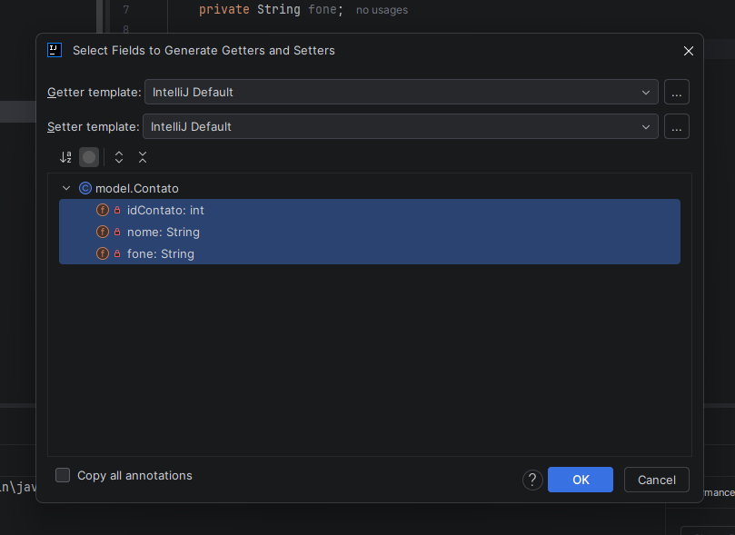
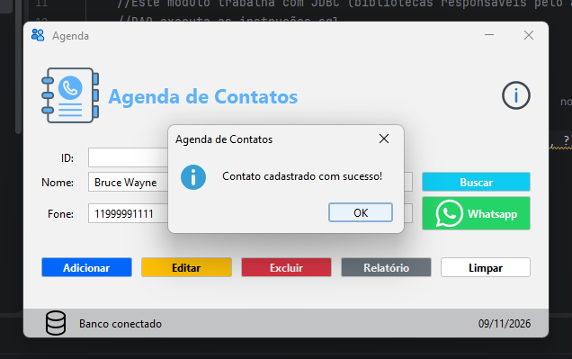
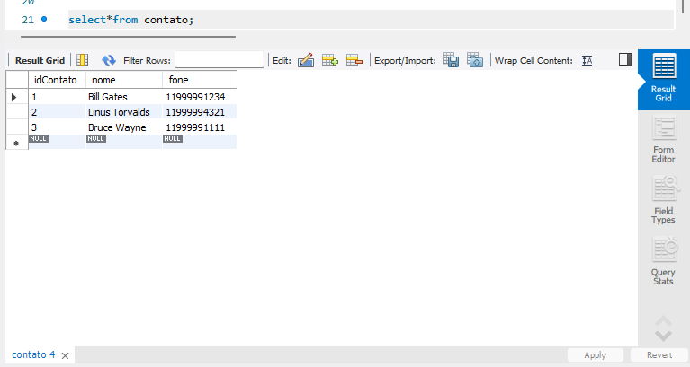

# Java - Agenda: DAO e Cadastro

> **Data:** 09 e 11 de novembro de 2026

Implementando o cadastro de contatos na Agenda.

---

## Criando a classe Contato

Para começar a implementação do cadastro, criamos uma classe chamada `Contato` dentro do pacote `model`.

Essa classe representa os dados de um contato e utiliza atributos correspondentes às colunas da tabela **contato**, já existente no banco de dados.

Inicialmente, declaramos três atributos:

```java
package model;

public class Contato {
    // Encapsular variáveis relacionadas à tabela
    private int idContato;
    private String nome;
    private String fone;
}
```

`idContato` → armazena o identificador do contato no banco de dados.  
`nome` → armazena o nome do contato.  
`fone` → armazena o número de telefone.

Os atributos foram declarados como private, seguindo o princípio de encapsulamento. Dessa forma, o acesso e a alteração desses valores são realizados por meio dos métodos *Getters e Setters*.

### Gerando Getters e Setters

Para gerar os métodos automaticamente pelo IntelliJ IDEA, clicamos com o botão direito dentro da classe e seguimos o caminho: **Generate...** → **Getters and Setters**



Em seguida, selecionamos todos os atributos e clicamos em OK.

Esses métodos permitem consultar e modificar os valores dos atributos, mesmo eles sendo privados.

### Código do Contato.java

Após a geração dos métodos, a classe ficou da seguinte forma:

```java
package model;

public class Contato {
    // No MVC Model é uma estrutura de dados
    // Encapsular variáveis relacionadas à tabela
    private int idContato;
    private String nome;
    private String fone;

    // Generate getter and setter

    public int getIdContato() {
        return idContato;
    }

    public void setIdContato(int idContato) {
        this.idContato = idContato;
    }

    public String getNome() {
        return nome;
    }

    public void setNome(String nome) {
        this.nome = nome;
    }

    public String getFone() {
        return fone;
    }

    public void setFone(String fone) {
        this.fone = fone;
    }
}
```

Com a classe `Contato` criada, já temos uma estrutura para armazenar os dados que serão utilizados durante o cadastro e as demais operações da **Agenda**.

---

## Criando a classe ContatoController

Após criar a classe `Contato`, seguimos para o pacote `controller`, onde criamos a classe `ContatoController`.

Essa classe será responsável por realizar as validações dos dados do contato antes de encaminhá-los para o DAO.

### Validando os dados do contato

Inicialmente, criamos o método privado validarContato(), responsável por verificar se o nome informado foi preenchido corretamente.

```java
private void validarContato(Contato contato) {
    if (contato.getNome() == null || contato.getNome().trim().isEmpty()) {
        throw new IllegalArgumentException("Informe o nome do contato.");
    }

    contato.setNome(contato.getNome().trim());
}
```

A validação verifica duas situações:

- `contato.getNome() == null`: verifica se o nome não recebeu nenhum valor.
- `contato.getNome().trim().isEmpty()`: remove os espaços das extremidades e verifica se o campo ficou vazio.

Caso alguma dessas condições seja verdadeira, o programa lança uma exceção utilizando `IllegalArgumentException`, apresentando a mensagem informando que o nome do contato deve ser preenchido.

Depois da validação, utilizamos `setNome()` junto com `trim()` para remover espaços desnecessários antes de continuar o cadastro.

Por exemplo, se o usuário digitar *`"  João Silva  "`*, o valor será ajustado para *`"João Silva"`*.

Essa validação evita que contatos sejam cadastrados sem nome ou com espaços desnecessários.

---

## Criando o pacote DAO e a classe ContatoDAO

Depois de preparar a validação dos dados no `ContatoController`, criamos um novo pacote chamado `dao` dentro de src/main/java.

Dentro dele, criamos a classe `ContatoDAO`, responsável por executar as instruções SQL e realizar a comunicação com o banco de dados.

### Implementando o método `adicionar()`

Dentro da classe `ContatoDAO`, criamos o método `adicionar()`, responsável por receber os dados de um contato e executar o cadastro no banco de dados.

A assinatura do método ficou assim:

```java
public void adicionar(Contato contato) throws SQLException {
```

`public`: permite que o método seja acessado por outras classes.  
`void`: indica que o método não retorna nenhum valor.  
`Contato contato`: recebe um objeto da classe `Contato`, contendo os dados que serão utilizados no cadastro.  
`throws SQLException`: indica que o método pode lançar uma exceção relacionada às operações com o banco de dados, que deverá ser tratada pela classe que chamar esse método.

### Preparando o comando SQL

Dentro do método, declaramos uma variável chamada sql, contendo a instrução responsável por inserir um novo contato na tabela:

```java
String sql = "insert into contato (nome, fone) values (?, ?)";
```

A instrução INSERT INTO realiza a inserção de um novo registro na tabela contato, preenchendo as colunas nome e fone.

Os símbolos "?" representam parâmetros que serão substituídos posteriormente pelos dados recebidos no objeto `Contato`.

Em seguida, instanciamos a classe `ConnectionFactory`, que já havíamos desenvolvido anteriormente, para utilizar seu método `conectar()`:

```java
ConnectionFactory fabrica = new ConnectionFactory();
```

Esse objeto será utilizado para estabelecer a conexão com o banco de dados.

### Abrindo a conexão e preparando o comando SQL

Para abrir a conexão com o banco de dados, preparar a instrução SQL e executar o cadastro, utilizamos o try-with-resources:

```java
try (Connection con = fabrica.conectar();
     PreparedStatement comando = con.prepareStatement(sql)
) {
    comando.setString(1, contato.getNome());
    comando.setString(2, contato.getFone());

    comando.executeUpdate();
}
```

Nesse trecho, utilizamos duas classes do JDBC:

`Connection`: representa a conexão estabelecida com o banco de dados.  
`PreparedStatement`: prepara a instrução SQL para receber os parâmetros e ser executada.

A variável con recebe a conexão criada por `fabrica.conectar()`. Em seguida, utilizamos `con.prepareStatement(sql)` para preparar o comando SQL armazenado anteriormente na variável sql.

Com o comando preparado, utilizamos `setString()` para preencher os parâmetros representados pelos símbolos ?:

`setString(1, contato.getNome())`: define o nome do contato no primeiro parâmetro.  
`setString(2, contato.getFone())`: define o telefone do contato no segundo parâmetro.

Depois de preencher os parâmetros, utilizamos `executeUpdate()` para executar a instrução SQL no banco de dados. Nesse caso, o método realiza a inserção de um novo contato na tabela contato.

O `try-with-resources` gerencia automaticamente os recursos utilizados, fechando a conexão e o `PreparedStatement` ao final da execução, mesmo que ocorra uma exceção.

Com isso, concluímos a implementação da operação Create (cadastro) do CRUD no DAO.

---

## Finalizando a classe ContatoController

Depois de criar o `ContatoDAO`, voltamos à classe `ContatoController` para integrá-la ao processo de cadastro.

### Instanciando o DAO

Primeiro, declaramos um atributo para criar um objeto da classe `ContatoDAO`:

```java
private final ContatoDAO contatoDAO = new ContatoDAO();
```

Com isso, o **Controller** passa a ter acesso aos métodos disponibilizados pelo **DAO**.

A palavra `final` impede que essa variável receba outra instância depois de inicializada, mantendo a mesma referência ao objeto durante o funcionamento do Controller.

### Criando o método adicionar()

Em seguida, criamos o método público `adicionar()`, responsável por organizar o processo de cadastro:

```java
public void adicionar(Contato contato) throws SQLException {
    validarContato(contato);
    contatoDAO.adicionar(contato);
}
```

Nesse método, temos duas chamadas importantes:

- `validarContato(contato)`: executa a validação dos dados do contato, verificando se o nome foi preenchido corretamente e removendo espaços desnecessários.
- `contatoDAO.adicionar(contato)`: encaminha o objeto validado para o DAO, que realiza a inserção no banco de dados.

O método também declara `throws SQLException`, permitindo que possíveis erros relacionados ao banco de dados sejam encaminhados para a classe que chamou o Controller.

Dessa forma, o `ContatoController` conecta as duas etapas do processo: primeiro valida os dados e depois solicita ao DAO que realize o cadastro.

---

## Integrando o cadastro à interface Agenda

Depois de finalizar a integração entre o `ContatoController` e o `ContatoDAO`, voltamos à classe `Agenda`, responsável pela interface gráfica do projeto.

O objetivo agora é fazer com que, ao clicar no botão **Adicionar**, os dados preenchidos no formulário sejam encaminhados para o Controller e posteriormente cadastrados no banco de dados.

### Instanciando o ContatoController

Primeiro, declaramos um atributo na classe `Agenda` (antes do construtor) para criar uma instância de `ContatoController`:

```java
private final ContatoController contatoController = new ContatoController();
```

Dessa forma, a classe Agenda passa a ter acesso ao método `adicionar()` do Controller, permitindo encaminhar os dados preenchidos pelo usuário.

### Criando o evento do botão Adicionar

Em seguida, configuramos o evento responsável por identificar quando o usuário clicar no botão Adicionar.

No IntelliJ IDEA, acessamos o formulário `Agenda.form`, clicamos com o botão direito sobre o botão azul Adicionar e seguimos o caminho: **Create Listener... → ActionListener → OK**.

Esse procedimento cria um evento **ActionListener** no construtor da classe `Agenda`.

Dentro do evento, adicionamos a chamada ao método adicionarContato():

```java
btnAdicionar.addActionListener(new ActionListener() {
    @Override
    public void actionPerformed(ActionEvent e) {
        adicionarContato();
    }
});
```

O método `actionPerformed()` é executado quando o botão é acionado. Nesse momento, ele chama `adicionarContato()`, que ficará responsável por organizar o cadastro.

### Criando o método adicionarContato()

Após o construtor da classe `Agenda`, criamos o método privado `adicionarContato()`.

Primeiro, instanciamos a classe `Contato` e utilizamos os métodos Setters para preencher seus atributos com os dados digitados nos campos do formulário:

```java
Contato contato = new Contato();

contato.setNome(txtNome.getText());
contato.setFone(txtFone.getText());
```

`txtNome.getText()`: obtém o nome digitado no campo de texto.  
`txtFone.getText()`: obtém o telefone digitado no campo de texto.  
`setNome()` e `setFone()`: armazenam esses valores no objeto Contato.

Assim, os dados preenchidos na interface são organizados em um objeto que poderá ser encaminhado ao Controller.

### Executando o cadastro e tratando as exceções

Com o objeto `Contato` preenchido, utilizamos um bloco `try-catch` para chamar o método `adicionar()` do Controller:

```java
try {
    contatoController.adicionar(contato);
}
```

Nesse momento, o Controller recebe o objeto, executa a validação dos dados e, caso esteja tudo correto, encaminha o contato ao DAO para realizar a inserção no banco de dados.

**1. Cadastro realizado com sucesso**

Se a operação for concluída sem erros, utilizamos `JOptionPane.showMessageDialog()` para apresentar uma mensagem de confirmação ao usuário:

```java
JOptionPane.showMessageDialog(
        this,
        "Contato cadastrado com sucesso!",
        "Agenda de Contatos",
        JOptionPane.INFORMATION_MESSAGE
);
```

O método `showMessageDialog()` exibe uma janela de mensagem. Nele, informamos a janela de referência `(this)`, o texto que será apresentado, o título da janela e o tipo de mensagem.

Nesse caso, `JOptionPane.INFORMATION_MESSAGE` define que será exibido um ícone de informação, indicando que o cadastro foi realizado com sucesso.

**2. Erro de validação**

Caso o nome não tenha sido preenchido corretamente, o Controller lança uma exceção do tipo `IllegalArgumentException`.

Essa exceção é capturada pelo primeiro `catch`, que utiliza `JOptionPane.showMessageDialog()` para apresentar uma mensagem de aviso ao usuário:

```java
catch (IllegalArgumentException e) {
    JOptionPane.showMessageDialog(
            this, e.getMessage(),
            "Atenção",
            JOptionPane.WARNING_MESSAGE
    );
}
```

Utilizamos `e.getMessage()` para recuperar a mensagem definida no Controller (`"Informe o nome do contato."`).

Já `JOptionPane.WARNING_MESSAGE` define o tipo de mensagem como um aviso, indicando que o usuário precisa corrigir os dados informados.

**3. Erro no banco de dados**

Caso ocorra algum problema durante a operação com o banco de dados, a exceção `SQLException` é capturada pelo segundo `catch`.

Nesse caso, utilizamos `JOptionPane.showMessageDialog()` para informar que não foi possível realizar o cadastro:

```java
catch (SQLException e) {
    JOptionPane.showMessageDialog(
            this,
            "Não foi possível cadastrar o contato. \n" + e.getMessage(),
            "Erro no banco de dados",
            JOptionPane.ERROR_MESSAGE
    );
}
```

Além da mensagem principal, utilizamos `e.getMessage()` para apresentar os detalhes do erro retornado pelo banco de dados.

Já `JOptionPane.ERROR_MESSAGE` define o tipo de mensagem como erro, exibindo um ícone correspondente.
 
Dessa forma, o usuário consegue identificar que houve uma falha durante a tentativa de cadastro.

Dessa forma, a interface consegue informar ao usuário se o cadastro foi realizado ou se ocorreu algum problema durante o processo, concluindo a implementação da operação **Create** do CRUD na Agenda.

### Testando o cadastro de contatos

Após implementar o método `adicionarContato()`, executamos a aplicação para testar o funcionamento do cadastro.

Preenchemos os campos de nome e telefone na interface da Agenda e clicamos no botão **Adicionar**.

Como resultado, o programa apresentou a mensagem **"Contato cadastrado com sucesso!"**, confirmando que o processo de cadastro foi executado sem erros.



Após realizar o cadastro pela interface, verificamos os registros diretamente no MySQL utilizando o comando SELECT * FROM contato;. O resultado apresentou os contatos armazenados na tabela, confirmando que os dados foram inseridos no banco de dados.



---

## Implementando o botão Limpar

### Desabilitando a edição do campo ID

Antes de implementar o botão Limpar, fizemos uma alteração no campo **txtId**, diretamente pelo arquivo `Agenda.form`.

Acessamos as propriedades do componente e desmarcamos a opção **enabled**.

Com isso, o campo ID fica desabilitado na interface, impedindo que o usuário digite ou altere seu conteúdo manualmente.

### Criando o método limpar()

No arquivo `Agenda.java`, criamos o método privado `limpar()` fora do construtor da classe:

```java
private void limpar() {
    txtId.setText(null);
    txtNome.setText(null);
    txtFone.setText(null); //sem máscara
    txtNome.requestFocusInWindow();
}
```

O método utiliza `setText(null)` para deixar os campos sem conteúdo.

Ao final, utilizamos `requestFocusInWindow()` para posicionar o cursor novamente no campo `txtNome`, permitindo que o usuário comece a digitar um novo contato sem precisar selecionar o campo manualmente.

Dessa forma, o método centraliza a limpeza dos campos e pode ser chamado sempre que necessário.

### Criando o evento do botão Limpar

Depois de criar o método `limpar()`, voltamos ao arquivo `Agenda.form` e clicamos com o botão direito sobre o componente `btnLimpar`.

Em seguida, seguimos o caminho: **Create Listener...** → **ActionListener** → **OK**

O IntelliJ IDEA gera o evento correspondente no construtor da classe `Agenda.java`. Dentro dele, adicionamos a chamada ao método `limpar()`:

```java
//evento do botão limpar
btnLimpar.addActionListener(new ActionListener() {
    @Override
    public void actionPerformed(ActionEvent e) {
        limpar();
    }
});
```

Dessa forma, quando o usuário clicar no botão **Limpar**, o evento será executado e chamará o método `limpar()`, apagando os conteúdos dos campos e posicionando o cursor novamente no campo de nome.

### Integrando o método limpar() ao cadastro

Anteriormente, após cadastrar um contato, era necessário clicar manualmente no botão **Limpar** para apagar os dados do formulário.

Para facilitar esse processo, adicionamos uma chamada ao método `limpar()` dentro do bloco `try` do método `adicionarContato()`, logo após a mensagem de sucesso:

```java
//caso OK
JOptionPane.showMessageDialog(
        this,
        "Contato cadastrado com sucesso!",
        "Agenda de Contatos",
        JOptionPane.INFORMATION_MESSAGE
);

//limpar os campos
limpar();
```

Com essa alteração, assim que o usuário confirma a mensagem de cadastro clicando em **OK**, o método `limpar()` é executado automaticamente.

Dessa forma, os campos são apagados e o cursor retorna ao campo de nome, deixando o formulário pronto para um novo cadastro.

É importante observar que essa chamada está dentro do `try`, após a confirmação de sucesso. Portanto, se ocorrer um erro de validação ou no banco de dados, os campos não serão limpos automaticamente.
