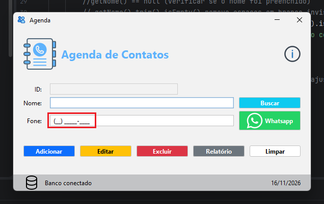
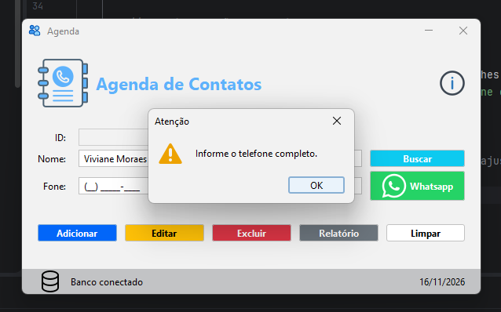
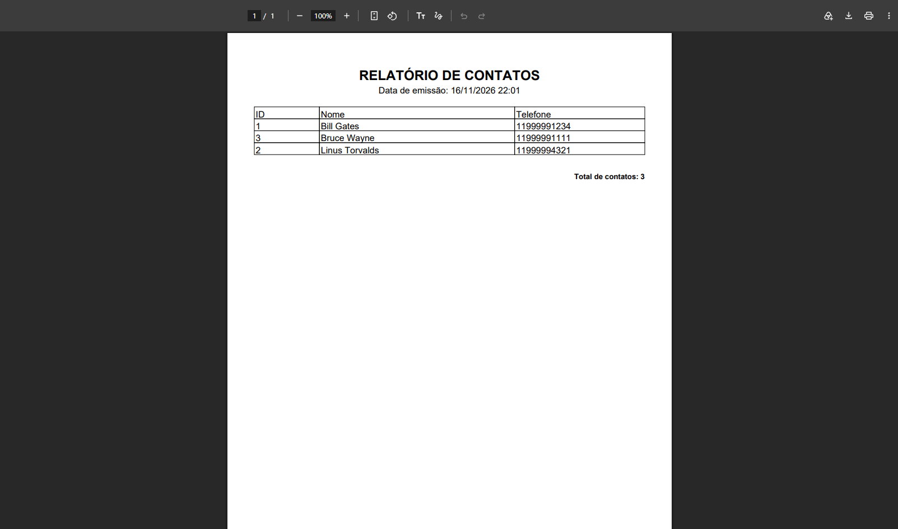

# Java - Agenda: Relatórios

> **Data:** 16 de novembro de 2026

Corrigindo problemas no cadastro de contatos e implementando a geração de relatórios.

---

## Corrigindo bugs no cadastro de contatos

### Aplicando uma máscara ao campo telefone

No arquivo `Agenda.form`, o antigo campo `txtFone`, que utilizava o componente `JTextField`, foi removido e substituído por um `JFormattedTextField`, mantendo o mesmo nome.

Em seguida, no arquivo `Agenda.java`, a declaração do componente também foi atualizada, acompanhando a alteração realizada pelo UI Designer:

```java
private JFormattedTextField txtFone;
```

### Configurando a máscara do telefone

No construtor da classe `Agenda.java`, foi adicionada a configuração da máscara utilizando `MaskFormatter`.

```java
//Uso de máscaras
try {
    //Máscara de telefone
    MaskFormatter mascaraFone = new MaskFormatter("(##) #####-####");
    mascaraFone.setPlaceholderCharacter('_');
    txtFone.setFormatterFactory(new DefaultFormatterFactory(mascaraFone));
    txtFone.setFocusLostBehavior(JFormattedTextField.PERSIST);
} catch (ParseException e) {
    System.err.println(e.getMessage());
}
```



Foram apresentados alguns caracteres utilizados na criação de máscaras:

- `#` - aceita apenas números.
- `A` - aceita caracteres e números.
- `U` - aceita apenas letras e transforma em maiúsculo (*uppercase*).
- `L` - aceita apenas letras e transforma em minúsculo (*lowercase*).
- `?` - aceita qualquer caractere, incluindo símbolos e espaços.

Para o campo de telefone, foi definida a máscara `(##) #####-####`, seguindo o formato de DDD e número de celular.

- `MaskFormatter` define o padrão de preenchimento do campo.
- `setPlaceholderCharacter('_')` utiliza o sublinhado como indicador dos espaços ainda não preenchidos.
- `setFormatterFactory()` aplica a máscara ao campo `txtFone`.
- `setFocusLostBehavior(JFormattedTextField.PERSIST)` mantém o conteúdo formatado mesmo quando o campo perde o foco.
- O bloco `try-catch` trata possíveis erros durante a configuração da máscara.

Também foi necessário alterar o método `limpar()`, substituindo `setText(null)` por `setValue(null)`, pois o campo agora utiliza `JFormattedTextField`.

```java
txtFone.setValue(null); //JFormattedTextField
```

### Validando o telefone no Controller

Mesmo com a máscara aplicada, ainda era possível tentar cadastrar um telefone incompleto. Para resolver isso, foi adicionada uma validação no método `validarContato(Contato contato)`, localizado na classe `ContatoController.java`.

```java
//regex(expressão regular)
//d{2} obrigar o preenchimento com 2 dígitos
//! not (se não corresponder com o telefone)
if (contato.getFone() == null || !contato.getFone().matches("\\(\\d{2}\\) \\d{5}-\\d{4}")) {
    throw new IllegalArgumentException("Informe o telefone completo.");
}
```



- `matches()` verifica se o telefone corresponde ao formato definido pela expressão regular (*Regex*).
- `\\d{2}` exige dois dígitos para o DDD.
- `\\d{5}` exige cinco dígitos antes do hífen.
- `\\d{4}` exige quatro dígitos depois do hífen.
- O operador `!` inverte o resultado da verificação.
- Caso o telefone esteja vazio ou não corresponda ao formato esperado, é lançada uma `IllegalArgumentException`.

Dessa forma, o cadastro passou a exigir o preenchimento completo do telefone.

### Limitando os caracteres do campo nome

Para limitar a quantidade de caracteres, foi adicionada uma classe interna chamada `LimiteCaracteres`, que utiliza `DocumentFilter`.

O código foi disponibilizado pelo professor e inserido na classe `Agenda.java`, antes do construtor.

```java
//filtro para Limitar os caracteres de um componente JTextField
private static class LimiteCaracteres extends DocumentFilter {

    private final int limite;

    public LimiteCaracteres(int limite) {
        this.limite = limite;
    }

    @Override
    public void insertString(FilterBypass fb, int offset,
                             String texto, AttributeSet atributos)
            throws BadLocationException {

        replace(fb, offset, 0, texto, atributos);
    }

    @Override
    public void replace(FilterBypass fb, int offset, int tamanho,
                        String texto, AttributeSet atributos)
            throws BadLocationException {

        if (texto == null) {
            texto = "";
        }

        int tamanhoAtual = fb.getDocument().getLength();

        int novoTamanho = tamanhoAtual - tamanho + texto.length();

        if (novoTamanho <= limite) {
            fb.replace(offset, tamanho, texto, atributos);
        }
    }
}
```

A classe `DocumentFilter` permite controlar as alterações realizadas no conteúdo do campo de texto.

- `insertString()` trata a inserção de novos caracteres.
- `replace()` controla a substituição de caracteres.
- `novoTamanho` calcula o tamanho que o texto terá após a alteração.
- A condição `novoTamanho <= limite` permite a alteração somente quando ela respeita o limite definido.

### Aplicando o limite ao campo nome

Depois de criar a classe `LimiteCaracteres`, foi necessário aplicar o filtro ao campo `txtNome`.

No construtor da classe `Agenda.java`, logo acima da configuração das máscaras, foi adicionado o seguinte código:

```java
//Limitar o campo txtNome
AbstractDocument documentoTxtNome = (AbstractDocument) txtNome.getDocument();
documentoTxtNome.setDocumentFilter(new LimiteCaracteres(30));
```

O código acessa o documento utilizado pelo campo `txtNome` e aplica o filtro `LimiteCaracteres`, definindo o limite de 30 caracteres.

Dessa forma, não é mais possível ultrapassar a quantidade de caracteres estabelecida no campo de nome.

---

## Implementando o relatório de contatos

Para iniciar a implementação, foi criado um novo pacote chamado `service`, responsável por organizar os serviços da aplicação.

Dentro dele, foi criada a classe `RelatorioService.java`, que recebeu um código disponibilizado pelo professor para gerar um relatório em PDF com os contatos cadastrados na agenda.

### Adicionando a biblioteca OpenPDF

Como a classe `RelatorioService.java` utiliza recursos da biblioteca OpenPDF, foi necessário adicionar sua dependência ao projeto Maven, no arquivo `pom.xml`.

```xml
<!-- Source: https://mvnrepository.com/artifact/com.github.librepdf/openpdf -->
<dependency>
    <groupId>com.github.librepdf</groupId>
    <artifactId>openpdf</artifactId>
    <version>3.0.5</version>
    <scope>compile</scope>
</dependency>
```

Após adicionar a dependência, o Maven consegue baixar a biblioteca e disponibilizar as classes necessárias para a geração dos relatórios em PDF.

### Criando o método listarTodos() no DAO

Na classe `ContatoDAO.java`, foi criado o método `listarTodos()`, responsável por buscar todos os contatos cadastrados no banco de dados.

```java
public List<Contato> listarTodos() throws SQLException {
    String sql = "select idContato, nome, fone from contato order by nome";

    List<Contato> contatos = new ArrayList<>();

    try (Connection con = new ConnectionFactory().conectar();
         PreparedStatement comando = con.prepareStatement(sql);
         ResultSet resultado = comando.executeQuery()) {

        while (resultado.next()) {
            Contato contato = new Contato();
            contato.setIdContato(resultado.getInt("idContato"));
            contato.setNome(resultado.getString("nome"));
            contato.setFone(resultado.getString("fone"));

            contatos.add(contato);
        }
    }

    return contatos;
}
```

- A consulta SQL busca o ID, nome e telefone de todos os contatos, organizando os resultados pelo nome (`ORDER BY nome`).
- O `ResultSet` permite percorrer os registros retornados pela consulta.
- Para cada registro, é criado um objeto `Contato`, preenchido com os dados do banco e adicionado à lista.
- Ao final, o método retorna a lista de contatos.

Esse método permite que a classe `RelatorioService` tenha acesso aos contatos cadastrados para montar o relatório.

### Integrando o RelatorioService à classe Agenda

Na classe `Agenda.java`, foi adicionada uma instância de `RelatorioService`, logo abaixo da declaração do Controller e antes do construtor.

```java
//service (relatórios)
private final RelatorioService relatorioService = new RelatorioService();
```

Essa instância permite que a classe `Agenda` utilize os métodos disponibilizados pelo serviço de relatórios.

### Criando o método gerarRelatorio()

Na classe `Agenda.java`, logo após o construtor, foi criado o método `gerarRelatorio()`, responsável por chamar o serviço de relatórios e apresentar uma mensagem ao usuário conforme o resultado da operação.

```java
//Gerar o relatório de contatos
private void gerarRelatorio() {
    try {
        relatorioService.gerarRelatorioContatos();
        JOptionPane.showMessageDialog(
                this,
                "Relatório gerado com sucesso!",
                "Relatório",
                JOptionPane.INFORMATION_MESSAGE
        );
    } catch (SQLException | IOException | DocumentException e) {
        JOptionPane.showMessageDialog(
                this,
                "Não foi possível gerar o relatório.\n" + e.getMessage(),
                "Erro",
                JOptionPane.ERROR_MESSAGE
        );
    }
}
//Fim relatório de contatos
```

- `gerarRelatorioContatos()` chama o método da classe `RelatorioService` que gera o PDF.
- Se a operação for concluída, é exibida uma mensagem de sucesso.
- O bloco `catch` captura possíveis exceções relacionadas ao banco de dados, à gravação do arquivo e à geração do PDF, apresentando uma mensagem de erro.

### Configurando o evento do botão Relatório

Primeiramente, no arquivo `Agenda.form`, foi criado um `ActionListener` para o botão `btnRelatorio`.

Em seguida, na classe `Agenda.java`, foi adicionado o evento responsável por chamar o método `gerarRelatorio()` quando o botão for acionado.

```java id="m8q2vn"
//evento do botão Relatório
btnRelatorio.addActionListener(new ActionListener() {
    @Override
    public void actionPerformed(ActionEvent e) {
        gerarRelatorio();
    }
});
```

Dessa forma, ao clicar no botão **Relatório**, o método `gerarRelatorio()` é executado e inicia o processo de geração do PDF.


